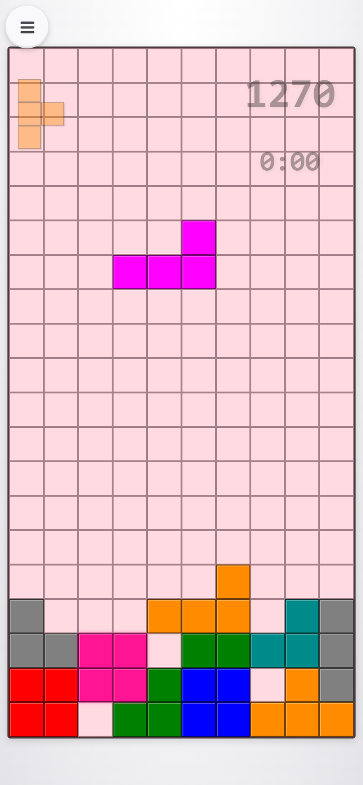
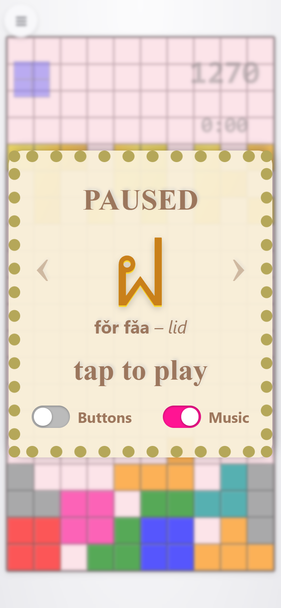
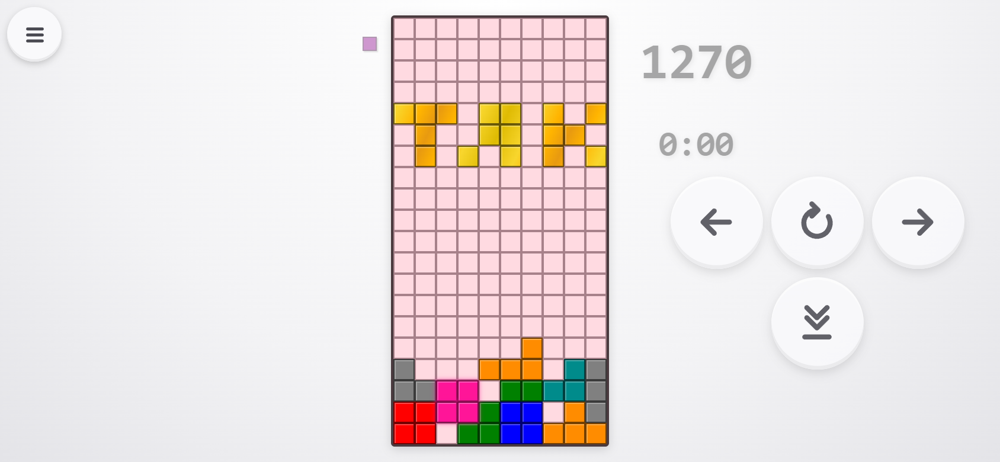

# gotetris

A small, warm Tetris made as a gift for Tak – play it at **[gotetris.com](https://gotetris.com/)**.

<p align="center">
  
  
</p>
<p align="center">
  
</p>

## What makes it special

- **Special pieces** – a golden **TAK** word (rotate it to break it into its letters T, A, K), a beating **heart**, and **Thai letters**. They crumble like sand when they land.
- **Learn Thai while you rest** – the pause screen shows a letter of the Thai alphabet with its name and meaning; swipe through all 44.
- **Music** – public-domain folk and classical tunes (Kalinka, Korobeiniki, In the Hall of the Mountain King, Can-Can) played live with WebAudio. They speed up with the game, and each tune plays three times before another takes over.
- **Plays anywhere** – one self-contained HTML file, no libraries; installable as an app; works on phones (portrait or landscape) and desktops.
- **Best score** kept in the browser.

## Controls

| | Touch | Keyboard |
|---|---|---|
| Move | drag sideways | ← → |
| Rotate | tap, or swipe up | ↑ |
| Down | drag down | ↓ |
| Drop | flick down | Space |
| Pause | ☰ top-left | P / Esc |

On-screen buttons can be switched on from the pause screen.

## Project layout

```
public/index.html      the whole game (HTML, CSS, JS, music)
public/original.html   the original version, kept for posterity
tools/song-test.html   song tester + MIDI importer for new tunes
tools/sync-song-test.js  copies the game's Music code into the tester
```

## Adding a song

Open `tools/song-test.html`, import a MIDI file (public domain or your own) or type a song, press Play, then paste the result into `Music.songs` in `public/index.html`:

```js
{
   name: "MySong",
   melody: "A G A E C E A2",       // notes, length in eighths; c = an octave up, A, = down
   chords: "Am:4 G7:2 Am:2",       // chord:eighths
   bass:   "A,,2 E,,2 A,,4",       // optional, written like the melody
   drums:  "k.h.s.h."              // optional, per sixteenth: k kick, s snare, h hat, o open hat
}
```

After changing the `Music` code, run `node tools/sync-song-test.js` so the tester matches.

## Running locally

Open `public/index.html` in a browser – no build step. It's deployed as static assets with Cloudflare (`wrangler.jsonc`).
